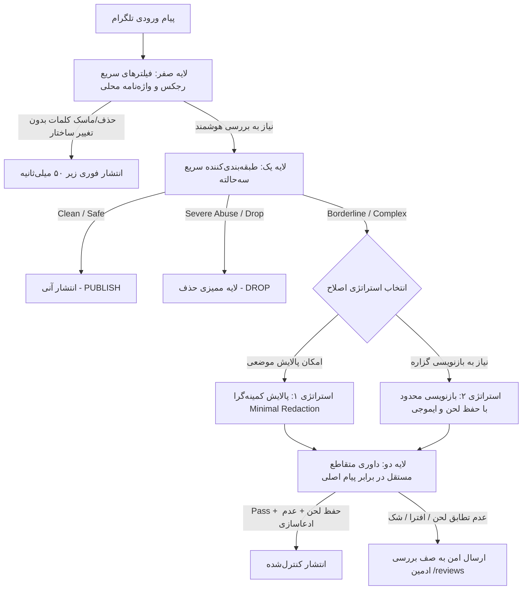

# سند جامع تحول و استانداردسازی گاردریل هوش مصنوعی (Guard Transformation Blueprint)
> **وضعیت:** تصویب‌شده و آماده اجرا  
> **نسخه:** ۲.۰.۰  
> **تاریخ:** اکتبر ۲۰۲۶  
> **مرجع الگوبرداری:** NVIDIA NeMo Guardrails, Meta Llama Guard 3, Guardrails AI, Azure AI Content Safety, LLM Guard  

---

## ۱. بیانیه مسئله و تحلیل کالبدشکافانه (Root Cause Analysis)

در تاریخ ۱۶ اکتبر ۲۰۲۶، حادثه‌ای در پردازش پیام ۲۹۰ تلگرام رخ داد:
* **پیام ورودی:**
  ```text
  چصی جدید کتاب های کمک درسی 😂
  کتابهای ماجرای ۲۰
  ```
* **پیام منتشرشده توسط سیستم:**
  ```text
  کتابهای کمکدرسیِ جدیدِ «ماجرای ۲۰» خیلی بد هستند.
  ```

### پنج نقطه شکست ریشه‌ای در سیستم فعلی:
1. **Semantic & Tone Drift (انحراف گزاره‌ای و نابودی لحن طنز):**
   یک شوخی تلگرامی با اسلنگ محاوره‌ای («چسی جدید = پُز / شوآف / حرکت عجیب و مسخره جدید») همراه با ایموجی خنده (`😂`) به یک **ادعای حقوقی قاطع و منفی علیه یک برند آموزشی («خیلی بد هستند»)** تبدیل شد که بار افترا و مسئولیت حقوقی برای گردانندگان کانال ایجاد می‌کند.
2. **The Rewriting Trap (تله بازنویسی آزاد به جای ویرایش کمینه‌گرا):**
   سیستم به جای اینکه صرفاً واژه نامناسب را پالایش/خنثی کند یا ماسک نماید، کل پیام را با پرامپت انشایی آزاد از نو تولید کرد.
3. **Cascading Hallucination (خطای آبشاری در داوری معنایی):**
   مرحله `meaning_judge` متن کاندید را در برابر `protected_meaning` ارزیابی کرد که خود در مرحله قبل توسط هوش مصنوعی با درک ناقص اسلنگ ایجاد شده بود (خطای خودارجاعی / Confirmation Bias). در نتیجه داور معنایی به جای رد کردن متن، آن را با اطمینان ۱.۰۰ تأیید کرد!
4. **Latency & Token Explosion (تأخیر بحرانی و اتلاف منابع):**
   برای یک پیام ۴۹ کاراکتری، ۵ درخواست سنگین ارسال شد و **۲۸.۸۸ ثانیه** سیستم معطل ماند (بیش از ۱۶۰۰ توکن خروجی و استدلال).
5. **اسپم لاگ در خطای اطلاع‌رسانی ادمین (`reviews.py`):**
   حلقه اطلاع‌رسانی به ادمین در صورت عدم استارت ربات توسط ادمین (`Chat not found`) هر ۶۰ ثانیه لاگ هشدار تکراری ثبت می‌کند.

---

## ۲. معماری هدف (Target Architecture: Guard v2)

معماری جدید بر اساس ۴ ستون اصلی از بهترین فریم‌ورک‌های دنیا بازطراحی می‌شود:



### اصول بنیادین گارد جدید:
1. **Minimally Invasive Principle (اصل حداقل دستکاری):**
   هیچ ساختار، لحن، ایموجی یا گزاره‌ای نباید تغییر کند مگر آنچه دقیقاً ناقض خط‌مشی است.
2. **Humor & Register Invariance (تغییرناپذیری طنز و لحن):**
   یک متن غیررسمی/شوخی/کنایه هرگز نباید به ادعای رسمی، خبری، یا گزاره قضایی/کیفی تبدیل شود.
3. **Direct Ground-Truth Judging (داوری مستقیم در برابر اصل پیام):**
   داور معنایی باید پیام تولیدی را مستقیماً با پیام اولیه کاربر مقایسه کند و بررسی کند آیا ادعای کذبی اضافه شده است یا خیر (`claim_entailment`).
4. **Fast-Fallback to Human-in-the-Loop (ارجاع سریع به ادمین در موارد مرزی):**
   اگر اطمینان بازنویسی کامل نیست، به جای حدس زدن و تولید متن کذب، در کمتر از ۵ ثانیه پیام به صف `/reviews` هدایت شود.

---

## ۳. تغییرات قراردادها و پرامپت‌ها (Contracts & Prompts Spec)

### ۳.۱. پرامپت استخراج معنا (`decompose_meaning`)
* افزودن صریح:
  * **نهی تبدیل شوخی/اسلنگ به قضاوت قطعی:** اسلنگ‌های محاوره‌ای نظیر «چسی»، «قپی»، «شوآف» یا اصطلاحات روزمره نباید به گزاره «خیلی بد است» ترجمه شوند.
  * **حفظ ایموجی‌ها:** ایموجی‌های بیانگر احساسات و لحن (`😂`, `😅`, `🤦‍♂️`) به عنوان بخش غیرقابل‌حذف (`protected_meaning`) علامت‌گذاری شوند.

### ۳.۲. پرامپت بازنویسی (`generate_rewrite`)
* تفکیک صریح میان:
  1. توهین مستقیم و ارزیابی کیفی شدید علیه یک محصول یا شخص
  2. کنایه و شوخی روزمره
* قانون بازنویسی کمینه‌گرا: حفظ ترتیب کلمات و جایگزینی معادل عامیانه محترمانه (مثلاً تبدیل «چسی جدید کتاب‌ها 😂» به «پز جدید کتاب‌ها 😂» یا «ادا و اطوار جدید کتاب‌ها 😂» به جای «کتاب‌ها خیلی بد هستند»).

### ۳.۳. پرامپت داوری معنا (`judge_meaning`)
* افزودن ۳ اعتبارسنج اصلی برگرفته از Guardrails AI:
  1. `tone_shift_check`: آیا پیام طنز به پیام جدی تبدیل شده است؟
  2. `defamation_check`: آیا ویژگی جدیدی به یک نهاد/برند نسبت داده شده که در اصل وجود نداشته؟
  3. `emoji_preservation`: آیا شاخص‌های عاطفی حذف شده‌اند؟

---

## ۴. بهبودهای زیرساختی جانبی (Bug Fixes & Hardening)

1. **مدیریت خطای `Chat not found` در `app/handlers/reviews.py`:**
   * اصلاح حلقه ارسال نوتیفیکیشن به ادمین‌ها: اعمال Exponential Backoff (تا ۱ ساعت) برای ادمین‌هایی که چت با ربات را آغاز نکرده‌اند تا از پر شدن لاگ‌ها جلوگیری شود.
2. **بهینه‌سازی بودجه و تایم‌اوت (`budget.py`):**
   * اضافه کردن سقف مصرف زمان برای مراحل میانی تا یک پیام تلگرامی ۲۹ ثانیه در پایپ‌لاین گیر نکند.

---

## ۵. راهنمای تحویل کار (Handover & Continuity Protocol)

اگر حین اجرای کار توسط هوش مصنوعی، خطای سقف پیام (Limit) رخ دهد:
1. هر تغییر باید در قالب یک فاز مستقل باشد و بعد از اتمام، تست‌های `pytest` اجرا شده و کامیت ثبت شود.
2. ایجنت یا برنامه‌نویس بعدی بلافاصله به فایل [GUARD_TRANSFORMATION_CHECKLIST.md](file:///d:/Habib/mtb/New%20folder/telegram-forwarder/docs/GUARD_TRANSFORMATION_CHECKLIST.md) مراجعه کرده و دقیقاً از اولین چک‌باکس علامت‌نخورده (`[ ]`) کار را ادامه می‌دهد.
